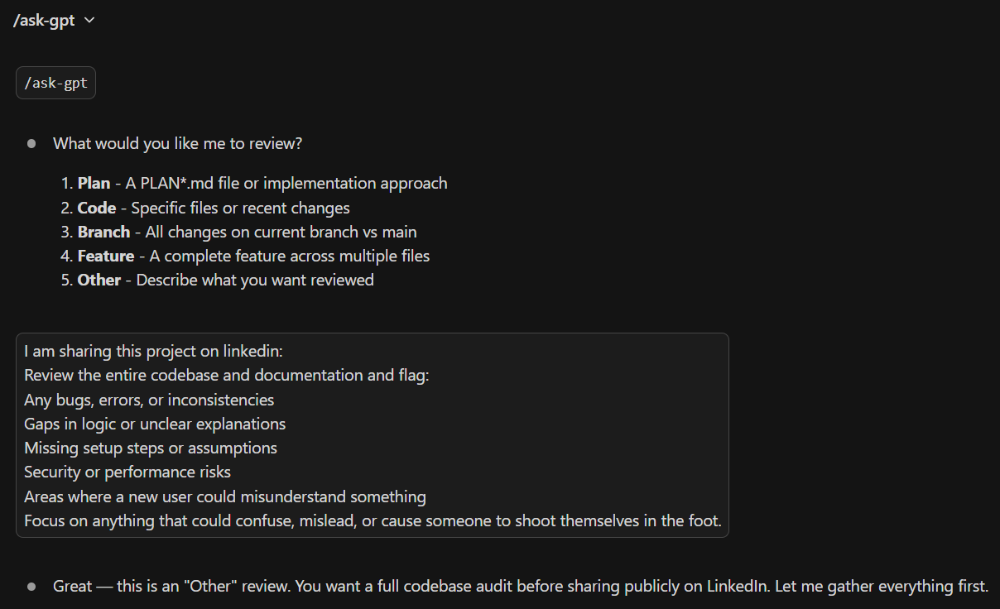

# Commands

How each command in the LLM Peer Review toolkit works, the two brakes on the loop, which review command to use, and how the debates run. The full command table, including every review skill, is in the shipped manual: [toolkit-reference.md](../.claude/skills/shared/toolkit-reference.md), under Slash Commands. On the plugin every command below carries the `tk:` prefix (`/tk:explore`); the copy-install uses the bare names shown here.

## The loop and its two brakes

You don't have to use every command every time. Following the order prevents the most common mistake: coding before you've thought it through.

**Two ways to take back control, and they do different things.** Say **"no chaining"** to stop the *handoff*: that run finishes its own stage and does not start the next one. Say **"report only"** to stop the *changing*: the run tells you what it found and edits nothing. They are deliberately separate, so you can have either without the other, and both last for one run only. One thing to know about a chained cycle: the review that follows `/execute` starts on its own, so there is no moment to type "report only" for it. If you want that review to change nothing, say "no chaining" when you approve the plan, then type `/review <start>..HEAD report only` yourself, with the `Start commit` sha `/execute` wrote at the top of the plan (a plain `/review` on a clean tree covers the plan's own commits while any of them are unpushed, else your newest 20 unpushed commits).

> **Want to see this in action?** Follow the 5-minute walkthrough in **[DEMO-SCRIPT.md](DEMO-SCRIPT.md)**.

> **Working on multiple things at once?** Use `/worktree` first to create an isolated copy, then open it in a new Cursor window and run `/explore` there. When the PRs are ready, `/merge` lands them, checked for lost work.

---

## How key commands work

These commands carry most of the workflow. Each has its own prompt file with the full prompt (under `.claude/commands/`, or `.claude/skills/` for the ones that are skills, like `/error-analysis`); the summaries below are the "what is this, when do I use it" view.

### `/explore` - Understand before you build

Asks 3-4 focused questions about scope, success criteria, and constraints before any code is written. It reads the issue, earlier plans, the code the change touches and your lessons first, and skips any question they already answer. Has two modes: **scoping** (you have a concrete idea, pressure-test the scope) and **vision** (you're thinking big-picture, challenge the premise itself). It picks a mode by reading your input, then asks you to confirm. You can switch modes any time. Useful when you're not yet sure what you're actually building. When the conversation converges (no open questions left, and in vision mode a scope dial reading Hold or Reduce), it hands off to `/create-plan` on its own.

**Models: best, fit or cheap.** Alongside its first questions, `/explore` asks how this cycle's helpers run: the review helpers are the specialists `/review` sends out, the map helper is the agent `/index` uses to build the codebase map, and your session model is the one this Claude Code session runs on. **Best** puts the review helpers on your session model and keeps the map helper on Sonnet, the model it was tested on. **Fit**, the default, uses the measured settings (review helpers on Opus, the map helper on Sonnet), never above your session model. **Cheap** puts them on Sonnet: cheaper, but in the toolkit's planted-bug test the Sonnet review helpers missed a bug the Opus ones caught. The judges (the audit, the fix check, the plan and design critics) run on your session model in every mode. `/create-plan` writes the answer into the plan as its `**Models:**` line, and a `mode:` word on `/review` or `/index` (`/review mode:cheap`) changes it for one run. Details: [`.claude/skills/shared/model-routing.md`](../.claude/skills/shared/model-routing.md).

**The design workflow.** When the feature has a look (a page, a screen, a component), `/explore` runs a named "Design exploration" step. It checks whether your repo already has a design system and asks you once, then sets a load level: nothing to design, improve something that exists, or build something new. New work gets an idea list you react to, three seeded working prototypes side by side to pick from, and then, during `/execute`, a design loop of up to five rounds (two when improving something that exists). Each round a fresh-context critic names the biggest gaps, a quick browser pass checks that typing and clicks survive the page redrawing, and a blind judge compares the new version with the one before, shown both ways round. The loop goes on while the new version wins both times. If it loses both times, the round's design changes are undone and the loop stops; a mixed result stops the loop and keeps the new version. The gaps the loop leaves open go to `/review` as must-check items instead of being lost. A repo that already has a design system keeps it: only layout, composition, motion, and copy vary, and anything further asks you first. Your repo's answers live in `DESIGN-PROFILE.md`, a file that is yours (seeded once by setup, never overwritten). Image and video generation are optional and sit behind your own keys; without a key the workflow hands you the prompt to run elsewhere and continues. The rules live in [`.claude/skills/shared/design-rules.md`](../.claude/skills/shared/design-rules.md); the keys are covered in [API-KEYS.md](../API-KEYS.md#media-generation-optional).

Full prompt: [`.claude/commands/explore.md`](../.claude/commands/explore.md)

### `/create-plan` - Turn an idea into trackable steps

Produces a `plans/PLAN-*.md` file with status emojis (🟥 To Do, 🟨 In Progress, 🟩 Done) and a progress percentage at the top. Tags each step `[parallel]` or `[sequential]` so `/execute` knows what can run concurrently. Each step names the check that proves it: a target that fails before the step's work, for a reason the plan states in advance, and passes after it, plus a guard on anything the step could break, written as lines the checks runner reads itself (see [Kinds of check](#kinds-of-check)). Captures critical decisions and (for UI features) the design choices made during `/explore`. Before you see it, a fresh-context plan critic lists its biggest gaps (no score, just the gaps) and they get fixed; the gaps from its second look are carried to `/review` as must-check items, unless the plan is right to leave them open (decided with you, or out of scope). The plan becomes your single source of truth for the feature. It runs on its own after `/explore` converges, then **stops and waits for you** - approving the plan is the one human gate in the cycle, and nothing gets built until you say go. A fit or cheap plan is built on Opus: when your session already runs on Opus, "go" starts the build there; otherwise the plan's closing message gives the steps for a fresh Opus session, because switching models inside the conversation would re-read everything uncached, which costs more than starting over.

Full prompt: [`.claude/commands/create-plan.md`](../.claude/commands/create-plan.md)

### `/execute` - Build it, update the plan as you go

<picture>
  <source media="(prefers-color-scheme: dark)" srcset="images/diagrams/execute-dark.svg">
  
</picture>

Walks through the plan step by step, updating status emojis and progress in real time: `[parallel]` steps run as parallel agents, `[sequential]` steps in order. Each step works check-first through the toolkit's checks runner (`run-checks.js`), as the picture shows: it writes the step's target (a new test case or must line) and none of the real work, a before run must show the failure the plan stated, then comes the work, and an after run where every target passes without a flake and every guard still holds. That after run is the step's green; both runs are saved under `reports/checks/<plan>/`. Small failures get at most 3 fix attempts per step, and a critical blocker (the plan assumed an API supports a feature it doesn't) stops the run and asks you instead of pushing through a broken plan. On a clean finish it hands off to `/review`.

The project's full test step, `npm test` or `pytest` by default, or exactly the checks in your `.claude/toolkit/checks.json` when that file exists, runs at each parallel checkpoint and at the plan's Verify step; npm's stock placeholder script counts as no tests. A plan written before steps carried their own checks runs the full test step after every step instead. The runner saves each log and reads back only the failing lines, and a failed or refused check turns the run red. A check that fails and then passes when run again is flaky and still counts as a fail; one that ran out of time is a plain fail. An older check that flakes, a guard already failing before the step's work, or a check that passed but took more than half its time limit does not stop the build: it goes to `/review` as a must-check line.

The full test step keeps track of its own cost. Each run's time is saved in `reports/checks/history.jsonl` in the main copy, so it carries over from one worktree to the next. A passing run that takes more than 1.5 times the usual time is flagged once, in the build's summary and on the cycle page, and its time becomes the new usual. Two passing runs in a row under two thirds of the usual time bring it down to the slower of the two, so after a speed-up the flag watches the new times, and one unusually fast run cannot make the next normal run look like growth. A run on code identical to the last passing run is skipped with a one-line note and counts as green. Identical means every tracked and new file the same, uncommitted edits included. `/merge` runs its tests the same way. The skip cannot see ignored files (installed packages, `.env.local`) or git tags and branches, so when one of those changed, the run is forced with `--no-skip`.

Full prompt: [`.claude/commands/execute.md`](../.claude/commands/execute.md)

### Kinds of check

`/create-plan` writes each step's checks as lines indented under the step, in three kinds:

- **Target:** the check that shows the step's change. It states in advance the one result only the missing behavior can produce, and it must show exactly that result before the work and pass after it.
- **Guard:** something the step could break, such as the tests of a module it touches or a sentence a rewrite has to keep. It passes before and after.
- **No target:** a step with nothing to show failing first, such as a refactor (guards only) or pure configuration, says why on this line, and the plan critic challenges the reason.

Each is one line under the step, in a shape the runner reads itself, with the expected result written as the runner's own JSON (`{"exit": 0}`, `{"match": "regex"}`, `{"noMatch": "regex"}` or `{"lines": {"min": 1}}`):

```
  - Check target `<id>`: `<command>` - before `<expect>` - after `<expect>`
  - Check guard `<id>`: `<command>` - `<expect>`
  - Check: no target - <reason>
```

Pick the target that shows the change:

| Kind | Fits when | What it checks |
|---|---|---|
| Example | A function, parser, calculation or data transform changes | This input gives this output |
| User flow | A feature a person uses changes | A real path through the product, end to end; the final word on whether a feature works |
| Must-never | Something must never happen, whatever the input | Many generated inputs try to break the rule |
| Old vs new | A step replaces something | Both versions run on the same inputs and the results are compared |
| Must and must-not lines | Text or a prompt changes | A count of a line the edit adds (0 before, 1 or more after) or removes (the reverse), plus a guard on each sentence the edit must keep |

**The stated failure.** A target's result before the work is written down in advance, and only the missing behavior can produce it: for a test, the new case's name in the suite's failure list, not just "the tests fail", because some other failure would satisfy that too. A crash or a missing file is not the stated failure: `/execute` adds the smallest stub, such as an empty function, and runs the check again.

**Why a check that already passes proves nothing.** A target that passes before the work would pass whether or not the work was done. So an absence check (a count of 0 or a no-match after the work) fits only a step that removes something, while a count of 0 before the work, for a line the step adds, is a must line's stated failure. When a target passes before the work, `/execute` fixes the check or its stated reason, never the work.

**The whole system** stays with the plan's Verify step: the project's full test step, a user flow end to end, and old against new when the plan replaces a system. A docs-only or config-only plan needs no Verify step.

The rules are M17 in [`.claude/skills/shared/hitl-stages.md`](../.claude/skills/shared/hitl-stages.md); the exact line shapes are under "Checks" in [`.claude/commands/create-plan.md`](../.claude/commands/create-plan.md).

### `/review` - Auto-detect what changed, run the right specialists, fix what they confirm

<picture>
  <source media="(prefers-color-scheme: dark)" srcset="images/diagrams/review-dark.svg">
  
</picture>

Looks at what changed (the commits `/execute` made, which it hands over as a range, plus anything uncommitted) and dispatches the relevant review skills (`/review-code`, `/review-security`, `/review-ux`, `/review-plan`, `/review-browser`, `/review-deps`, `/review-copy`, and others) in parallel. Typed with no range, it takes the newest plan's own commits while any of them are unpushed, else your unpushed commits, and the report opens by naming that range and why it chose it.

Before you read anything, every finding passes the three-tier audit in the picture: its receipt (a runnable check, like a grep or a test) is run from your project root by the checks runner and judged by machine (read-only commands only; a refused check fails the receipt), survivors face a fresh skeptic whose default is to refute, and a Block must also survive a three-skeptic vote. The plan's must-check items (gaps the plan or design critics left open, and the slow, flaky or broken-before checks `/execute` carried on past) go through the same audit, as does one finding for each plan step whose checks are missing, would not run, or did not prove it in their saved records (a plan written before steps carried checks gets none). Surviving step findings come to you rather than being fixed, because a step cannot be proved after its work.

The report shows only the survivors: one sentence carrying the defect and its harm, a second only when it says who is hit or when it fires, a fix line that states a cost, and the check that proves it. What the audit killed is listed one line each in an "Audited out" log, never fixed. Survivors are fixed automatically and each fix is re-verified (max 2 rounds) instead of assumed done. In a project with tests, a logic bug a test can show is fixed check-first: a test written in your project's tests fails for the bug's reason, the fix makes it pass, and the test stays, so the bug cannot come back unseen. The run ends with a summary showing the check behind every fix, then hands off to `/document`, which updates the docs, commits, and pushes behind a secret-scanning tripwire. You stay in control at the plan approval, at every stop where a decision genuinely needs a human (for example, edits to the toolkit's own prompt files), and through the two per-run brakes, "report only" and "no chaining" ([the loop and its two brakes](#the-loop-and-its-two-brakes)).

**One review page per branch.** The review's page (published privately when your session can publish) shows what is still open, and it is replaced in place on every run. Your default branch has one page; every other branch, such as a worktree's, gets its own, named after the branch and starting empty, so cycles running side by side never overwrite or wrongly close each other's findings. Both the review pages and the cycle summary `/document` keeps are saved in the main copy's `artifacts/html/`, whichever worktree ran them, so removing a worktree loses neither. The cycle summary is one shared log for the whole repository.

**Where the time went.** The cycle summary also shows where the cycle's time went: Claude working, tests, helper agents, waiting on you, and away (gaps over 15 minutes). It counts test and check runs (the full test runs among them), your messages, and quiet stretches where Claude showed nothing for over 2.5 minutes (time already inside the rows above), plus what the full test runs cost against their usual time. The cycle runs from the first `/explore` or `/create-plan` after the last `/document`. A cycle that began in the main copy and carried on in a worktree is counted whole, but a worktree running a cycle of its own beside it is a parallel cycle and is left out, its time and its stage markers both. A worktree reused for a new cycle times the new one. It is read from the session logs as times and counts only: no message text, command or file path leaves them, nothing is stored, and the correction-ledger opt-out (`.claude/.no-correction-log`) turns it off too.

Directly-typed `/review-*` runs are audited the same way before their reports - expect a few extra sub-agents (a skeptic per 7 findings, plus three voters for Block-severity findings) after the review itself, announced before they run. Loop rules: `.claude/skills/shared/hitl-loop.md` and its continuation `.claude/skills/shared/hitl-stages.md`.

Full prompt: [`.claude/commands/review.md`](../.claude/commands/review.md)

### `/merge` - Land finished worktree PRs without losing work

When several worktrees run at once, each branch is blind to what lands on main after it was cut. A conflict fixed while landing one of them can quietly drop work it never saw, or its own work, and a squash merge hides the fix. `/merge 241 242` lands PR #241 and then PR #242, in the order you give, one at a time. For each one it brings the branch up to date with main and fixes the conflicts (the lessons files keep both sides, generated files are rebuilt, the changelog block goes back where new entries go), then lands it only when four checks pass:

- your tests (your `checks.json`, or `npm test` or `pytest`);
- **nothing other work added after the cut is removed** (rule 1);
- **every line the PR added makes it in** (rule 2);
- **no decision contradicts one that landed after the cut** (rule 3): a fresh reviewer compares this PR's decisions with theirs, even across files, so "go right" in one PR and "always go left" in another's guide is caught.

All four key on the branch's **cut point**, the commit it was cut from, which `/worktree` records when it makes the branch. Git's merge-base cannot stand in for it: once a branch is updated from main, the merge-base moves past every line the branch never saw. `/document` writes the cut, the plan's decisions and the changelog block into the PR, and the landing commit repeats them, so they survive a squash and a deleted worktree.

**What stops it.** The first flag, failing test or contradiction stops that PR before anything lands, and tells you in plain English what would be lost and who wrote it. You choose: Claude fixes it, you keep it on purpose, or you stop.

**What it tells you when nothing stops it.** The line saying the PR landed names every file the landing deletes from main. A file the branch stopped tracking but means to keep (removed from git and added to an ignore file) is saved before the merge or the pull would delete your main folder's copy, then put back. A conflict combined inside a command, skill, agent or rules file always waits for your yes, even when every check is clean.

**Keeping a removal on purpose.** Sometimes removing a line is right. Say "keep it" and the landing commit records `Kept on purpose: <sha> <file>: <line>`; after the fact, an empty commit on main carrying the same line does the same. The record names the commit that wrote the line, so the same text written by another commit is still checked.

**How it lands.** It follows your repo's habit: a merge commit made on your machine (nothing is pushed), or the host's merge or squash through `gh` or `glab`, which asks first and is refused by the host if the PR moved after the checks. Rebase merges are not offered: a rebase leaves no landing commit to carry the record, so a rebase habit lands as a squash. With the host's merge it first waits, up to 90 seconds, until the host reports the PR mergeable, and when main moved on the host in the meantime it runs your tests once more on the new main before the next PR.

**Open review findings.** A landed branch's review page stays its own. When it still has open findings, the line saying the PR landed ends with how many and the page's link; they are not moved onto main's page.

**Landings made another way.** Each run first checks every landing since its last run, so a PR merged with the host's merge button is still checked, one step later. A squash made with the button is checked only when its PR carries the `Cut from:` line `/document` writes, and then only for other work it removed: a squash keeps no branch to compare its own lines against. A rebase made with the button is listed as not checkable, and a squash made with GitLab's button looks like an ordinary commit and is not seen.

It is human-triggered and never chained into: which PR lands first is your call.

Full prompt: [`.claude/commands/merge.md`](../.claude/commands/merge.md) | Rules: [`.claude/skills/shared/merge-rules.md`](../.claude/skills/shared/merge-rules.md)

### `/ask-gpt` and `/ask-gemini` - Debate with another AI

Run an automated debate between Claude and ChatGPT (or Gemini) about your code or plan; the toolkit carries every message, so you copy nothing by hand. They push back on each other and concede points for up to 3 rounds (it ends after round 2 when both fully agree), then produce a structured verdict: Agreed / Disagreed / Recommended Actions. Recommended Actions use the same two-sentence finding contract as `/review` (one sentence carrying the defect and its harm, a second only when it says who is hit or when it fires, and a fix line that states a cost), so the output model is consistent across all peer-review surfaces. Want a different perspective? Run `/ask-gemini` after `/ask-gpt`.

Each debate typically costs $0.01-$0.10 in API credits, depending on context size, and needs an OpenAI and/or Gemini API key with credits: [API-KEYS.md](../API-KEYS.md) walks through the setup.

**Choosing what to review:**



```
You: /ask-gpt

Claude: What would you like me to review?
        1. Plan    2. Code    3. Branch    4. Feature    5. Other

You: Review the auth middleware

Claude: [Gathers context → sends to ChatGPT → they debate up to 3 rounds]

        --- Summary ---
        Agreed: Add token expiry check, extract magic numbers

        Recommended Actions:
        - [ ] Add token expiry validation
        - [ ] Move 3600 to TOKEN_EXPIRY_SECONDS

        Want me to implement these?

You: Yes
```

Full prompts: [`.claude/commands/ask-gpt.md`](../.claude/commands/ask-gpt.md) | [`.claude/commands/ask-gemini.md`](../.claude/commands/ask-gemini.md)

### `/error-analysis` - find out what you keep correcting

Every time you step in during a cycle, correcting Claude or asking for something different, `/document` records it as one row in a ledger with a short note in your own words about what went wrong. `/error-analysis` reads those notes across every cycle, groups them into categories, counts them, and ranks them, so the thing you fix is the one that actually keeps happening rather than the one that happened most recently. It refuses to rank on fewer than ten rows, because a ranking built on two data points is the exact mistake it exists to prevent. It also shows each category's share month by month, so you can see whether a kind of correction falls after a change meant to prevent it; the month view says when a share moved, never why.

Everything is recorded at `~/.claude/correction-ledger.jsonl`, per machine, outside every repo, so you can open it and read exactly what is stored. A row holds your note plus four private fields: what you had asked, what Claude produced and what was wrong (each capped at 300 characters), and your own rewrite of what you wanted, when you wrote one (capped at 1,200). Those never leave your machine: they are excluded from every summary by construction, only a session opened in the repo they came from can read them back (the fix loop's evidence step below), and this command never publishes and never sends anything to another model. To stop future capture in a repo, `touch .claude/.no-correction-log`. That records nothing further; rows already written stay until you delete the file yourself. For a test run that should not touch your real ledger, set `TK_LEDGER_DIR` to an absolute folder: the ledger and its other files are then written there, while capture still reads your real session transcripts.

Each category also gets a home, the place its fix belongs, worked out from how widely it spreads. A category seen in one repo belongs in that project's own files. One seen in several repos belongs in your global instructions file (`~/.claude/CLAUDE.md`), unless most of its rows came up during the toolkit's own stages (`/explore`, `/create-plan`, `/execute`, `/review` and `/document`); then it belongs in the toolkit itself.

When you act on one, the fix loop reads that category's rows from inside the repo they came from, drafts the fix for its home, and waits for your approval. A global or toolkit fix is written in generic words. A toolkit fix leaves its repo only as a generic note you approve, which is filed as an issue in the toolkit's GitHub repository.

Once a fix lands you record it, and later rankings show the category's rate per `/document` cycle before and after it; a change counts as real only once each side has at least five cycles. Rows recorded before the request and rewrite fields existed can have them filled in from transcripts still on disk, when you ask, without adding any row.

Full prompt: [`.claude/skills/error-analysis/SKILL.md`](../.claude/skills/error-analysis/SKILL.md)

### `/create-issue` - issues that don't bloat

Asks 2-3 clarifying questions first, then creates a short (10-15 line) issue via `gh issue create` on GitHub or `glab issue create` on GitLab. It picks the right one by reading your git remote, so there is nothing to configure. No implementation details; that's what `/explore` and `/create-plan` are for. Good for capturing bugs and ideas without context-switching out of your editor.

Full prompt: [`.claude/commands/create-issue.md`](../.claude/commands/create-issue.md)

### `/index` - the codebase map

Writes `CODEBASE_MAP.md`, a short map of the project that `/explore`, `/create-plan` and `/pair-debug` read so they know where things live. Each module in the map lists the files it covers on a `**Files:**` line. `/document` refreshes the map when it is 10 or more commits behind.

Once a map exists, `/index` refreshes it rather than rebuilding it. It asks git which files changed since the commit the map was made at, sends only the modules that cover those files, plus any new files, to a helper, and copies every other part of the map across unchanged. On this repository a refresh took one helper and about an eighth of the tokens of a full rebuild. `/index full` rebuilds the whole map.

A refresh switches to a full rebuild on its own, and says why, when there is no map, the map has no `**Files:**` lines (every map written before 8.0.5), the map's commit is not on this branch, or the change would need four or more helpers. At the end it says how many modules it updated, added, dropped and kept, and how many files no module covers; `/index full` fills those in.

Full prompt: [`.claude/commands/index.md`](../.claude/commands/index.md)

### `/cloud` - run research and review on cloud

Runs a piece of work on cloud, in a Claude Code cloud session on Anthropic's machines, instead of on yours. `/cloud research "<question>"` runs a research report in any project; `/cloud review [<range>]` runs a report-only review of a range of commits. Add `model:<name>` or `effort:<level>` to set the cloud session's model and effort; the research readers (the six helpers that do the reading) run on Sonnet either way. It runs only when you type it: nothing else in the toolkit asks whether to use the cloud.

A run goes like this:

1. You type the command. It writes a self-contained brief, which is everything the cloud session will know besides your repository, and a small `start.sh` beside it, and tells you where both are, so you can read what is sent.
2. You start the session from a terminal by pasting the one line it gives you, `bash <folder>/start.sh`. Claude Code cannot start a cloud session from Claude's own shell, so this step is always yours, and running it is your go-ahead to use the cloud. The line uploads your local repository, unpushed commits included, to Anthropic's cloud (not to GitHub); files named like credentials, and gitignored files, stay on your machine. It prints the session's link and returns.
3. The session works on its own. Watch it from that link, at claude.ai/code or in the Claude app. Near the end it asks once for permission to publish its page to claude.ai: approve it there (the page stays private to you), and soon, because a session waiting on a prompt counts as idle: its cloud machine pauses, and a paused machine can later be reclaimed, losing the run's files.
4. When it has finished, say "done" (in a new session, type `/cloud done`). It reads the session's private claude.ai page back, saves the report and every file the run produced (each reader's findings, the checker's verdicts, notes, the review's own report files), and shows you only the summary. In an editor without a tool that reads your claude.ai pages, such as Cursor, it asks you to paste the session's last message instead.

The report lands in `reports/cloud/<date>-<name>/` when your project ignores `reports/`, otherwise in `~/.claude/cloud-reports/<project>/<date>-<name>/`, outside the repository, with the run's other files under `files/`.

Before your first run: the Claude Code command line must be signed in with your claude.ai account (`claude auth login`). Because the repository is uploaded, the cloud does not need to reach it on GitHub. For research, set the cloud environment's network to Full: on the default Trusted level, a web page fetch failed when we tested it.

Limits:

- Review runs only in a repository that carries the toolkit's own files, such as this toolkit's own repository, because cloud sessions never load plugins. In a project that uses the plugin, `/cloud review` says so and starts nothing; `/cloud research` works there.
- The review's plan check has nothing to compare in the cloud: plan files are gitignored, so they do not travel.
- The brief tells the cloud session to change nothing git would commit and to end its report with the output of `git status --porcelain`. When that line is not empty, `/cloud` tells you, because the session's branch may then have been pushed to GitHub.

Full prompt: [`.claude/skills/cloud/SKILL.md`](../.claude/skills/cloud/SKILL.md)

---

## Which review command do I use?

| I need to... | Use |
|---|---|
| Check code for bugs, logic, and quality | `/review-code` |
| Security-check a code change (injection, secrets, XSS, ...) | `/review-security` (auto-runs inside `/review`) |
| Check dependencies/packages for known vulnerabilities (CVEs) | `/review-deps` |
| Deep whole-repo security audit (auth, secrets, crypto, history) | `/security-audit` |
| Review slash command prompts and workflows | `/review-commands` |
| Verify implementation matches a plan | `/review-plan` |
| Evaluate UX, accessibility, and user flows | `/review-ux` |
| QA a running web app via headless browser | `/review-browser` |
| Check if copy is clear to a fresh reader | `/review-copy` |
| Pre-release go/no-go check across all domains | `/review-full` |
| Run a report-only review on cloud (a repository that carries the toolkit's own files) | `/cloud review` |
