# How LLM Peer Review works

LLM Peer Review is a general-purpose toolkit for building with Claude Code. You type `/tk:explore`, answer a few questions and approve one plan; the rest runs as a line, and at every stop a model that did not do the work checks it. This page shows that line, each stop on it, the two hooks that guard it, and where every file lives. Each picture has a short text version under it.

**How to read the pictures.** The thick blue line runs on its own. A dotted line is a step you start. A blue-tinted shape is a check the work must pass: a fresh-eyes judge (a model that sees the work without having done it), a test, or a question the step settles before it moves on. Solid blue is you approving, or the next command taking over (outlined when it waits for you). Amber marks a loop that repeats work (its limit is written on it), a side trip off the line, or a notice to you. A dashed box is a hook. Red means the line stops or asks you; green means done. The files picture uses its own three: blue-tinted for the toolkit's files, green for yours, grey for files made as you work.

The commands carry the `tk:` prefix on the plugin. On the copy-install for other editors the same commands run without it (`/explore`).

## The whole line

<picture>
  <source media="(prefers-color-scheme: dark)" srcset="images/diagrams/overview-dark.svg">
  
</picture>

1. **Gate in.** When Claude Code opens, a hook checks the plugin and your project are on the same version.
2. **You start the line** with `/tk:explore` and approve the plan `/tk:create-plan` writes. That approval is the one stop that waits for you.
3. **The rest runs on its own:** `/tk:execute` builds it, `/tk:review` audits and fixes it, `/tk:document` writes it up. Each amber stop is a loop with a hard limit, so nothing goes round forever.
4. **Dotted lines are yours to start:** `/tk:merge` lands work from a parallel worktree, and `/tk:ask-gpt` or `/tk:ask-gemini` starts a debate with another model.
5. **Gate out.** Before any push Claude makes, a check looks for secrets and other things that must not leave your machine.

Two phrases change a run: "report only" stops the editing, "no chaining" stops the handoff to the next stop.

## Station by station

### `/tk:explore`: question the idea before any code

<picture>
  <source media="(prefers-color-scheme: dark)" srcset="images/diagrams/explore-dark.svg">
  
</picture>

- **It reads before it asks:** the issue, earlier plans, the code the change touches and your lessons file, so it never asks what the repo already answers.
- **Two quick choices first:** scoping (narrow a concrete idea) or vision (think bigger), and which models to use: best, fit or cheap.
- **Then questions, in rounds:** three or four at a time, over two or three rounds. In vision mode a scope dial lets you expand, hold or reduce. Work with a screen gets a design step: three directions drawn for you to pick from.
- **It hands off only when nothing is left open.** With an open question it stops and says what it needs, or you say "plan it anyway".

### `/tk:create-plan`: a plan with a check on every step

<picture>
  <source media="(prefers-color-scheme: dark)" srcset="images/diagrams/create-plan-dark.svg">
  
</picture>

- **Every step carries its own proof:** a check that must fail before the work, for a reason written in advance, and pass after it. A lint confirms each check line can actually run.
- **A plan critic reads it cold.** It sees only the plan and the exploration's summary, never who wrote it or what earlier critics said, and names the biggest gaps.
- **Two rounds of fixes at most.** Gaps still open after round two are not argued away; they go on the review's must-check list.
- **This is where you approve.** The plan opens as a page; nothing is built until you say go.

### `/tk:execute`: build it check-first

<picture>
  <source media="(prefers-color-scheme: dark)" srcset="images/diagrams/execute-dark.svg">
  
</picture>

- **Check first, every step:** the check must fail before the work for the reason the plan stated, and pass after it. A check that already passes proves nothing, so it does not count.
- **Every green step is committed,** so a later problem can be undone one step at a time.
- **Three fix attempts per step, then it stops and asks you.** It never pushes through a broken plan.
- **Steps that build a screen run a design loop:** a fresh critic names the biggest gaps, and a side-by-side judge, never told which version is newer, decides whether each round made it better. Up to five rounds for something new, two for an improvement.

More on all three: [How key commands work](COMMANDS.md#how-key-commands-work).

### `/tk:review`: audit every finding, then fix

<picture>
  <source media="(prefers-color-scheme: dark)" srcset="images/diagrams/review-dark.svg">
  
</picture>

- **Finders look, one per lens:** code, security, UX, copy, plan compliance and more, picked by what changed.
- **Every finding brings a check anyone can run.** A finding whose check does not show what it claims is dropped before anyone argues about it.
- **Skeptics try to knock the rest down:** one skeptic per seven findings, and three independent votes on anything marked Block. What they refute goes to the audited-out log, not into your code.
- **Survivors get fixed, and the fixer never grades its own fix.** A separate verifier, or the original check run again, decides.
- **Two tries, then stop.** A fix still failing after two tries is undone and you are asked.

More: [How key commands work](COMMANDS.md#how-key-commands-work).

### `/tk:document`: write it up, keep what you taught it

<picture>
  <source media="(prefers-color-scheme: dark)" srcset="images/diagrams/document-dark.svg">
  
</picture>

- **The docs catch up with the code:** README, CLAUDE.md, the changelog, the lessons file and the design profile.
- **It notices what you had to correct** and keeps it in a correction ledger that never leaves your machine. Nothing is saved until you accept it.
- **A cycle page says what changed and why,** refreshed every run.
- **From a worktree it pushes the branch and opens a pull request** (a `/tk:document` you type yourself asks first), which you land with `/tk:merge`. The line ends here.

### `/tk:merge`: land parallel work without losing any

<picture>
  <source media="(prefers-color-scheme: dark)" srcset="images/diagrams/merge-dark.svg">
  
</picture>

- **You choose the order:** `/tk:merge 241 242` lands one pull request, then the next. It is never started for you.
- **Four checks before anything lands:** the project's tests, plus three rules keyed on where the branch was cut. Would this landing remove work another one added? Do all of this branch's own lines arrive? Does one of its decisions contradict a decision that landed after it was cut? A fresh decision checker judges the last one.
- **Any flag stops that pull request** and asks you: fix it, keep it on purpose, land it as it is, or stop.
- **Landing on GitHub or GitLab asks you once** per run.

## Gate in and gate out

<picture>
  <source media="(prefers-color-scheme: dark)" srcset="images/diagrams/hooks-dark.svg">
  
</picture>

- **Gate in is the plugin's one Claude Code hook.** It runs every time a session starts, keeps a stable path pointing at the installed plugin, and when the plugin and your project are on different versions, or an old copy-install is still around, tells you what to run: update the plugin, `/tk:upgrade` or `/tk:setup`.
- **Gate out is the pre-push check,** a script Claude runs before every push it makes. It reads what the push adds: secrets in any new line; files that must never leave your machine (`.env` files, `.claude/settings.local.json`, the correction ledger); a permission change in `.claude/settings.json`; and a plugin older than the project.
- **Any hit blocks the push and asks you.** A push you type yourself in a terminal is not checked unless your repo wires the same script in as a git hook.

## Side trips

<picture>
  <source media="(prefers-color-scheme: dark)" srcset="images/diagrams/side-trips-dark.svg">
  
</picture>

- **`/tk:ask-gpt` and `/tk:ask-gemini`** argue a plan or a change with another model for up to three rounds and end with a verdict: what they agreed on, what they did not, and ranked actions. The actions go through the same audit as review findings before anything changes.
- **`/tk:peer-review`** takes findings you paste from any other model and sorts each into real, opinion or dismissed, checked against the code.
- **`/tk:worktree`** opens a parallel folder and branch so two pieces of work never collide; that work lands later with `/tk:merge`.
- **`/tk:index`** writes `CODEBASE_MAP.md`, the map every stop reads first. It runs on its own when the map is missing or ten or more commits old.

## Where files live

<picture>
  <source media="(prefers-color-scheme: dark)" srcset="images/diagrams/files-dark.svg">
  
</picture>

- **The toolkit stays in the plugin cache** and changes only when you update the plugin. None of its commands, skills, agents or scripts are copied into your project.
- **`/tk:setup` seeds a few files once, then they are yours** and are never overwritten: `CLAUDE.md`, `LESSONS.md`, `DESIGN-PROFILE.md`, `.claude/settings.local.json`, and `.claude/toolkit/` for your own extensions.
- **`.claude/rules/toolkit.md` is the toolkit's short rules file.** Your own notes go under its project line, and `/tk:upgrade` keeps them when the rules change.
- **Working files stay out of git:** `plans/`, `artifacts/html/`, `reports/` and `CODEBASE_MAP.md`.

More: [How It Works: File Architecture](EXTENDING.md#how-it-works-file-architecture).

## What leaves your machine

The toolkit sorts everything it could send into three rings. Only the first is automated out of the box; the second needs an opt-in you write; the third is never automated.

- **Ring 1, automated, and only in the toolkit's own public repository:** stripped command text (file bodies replaced by size markers, long quoted strings cut, anything secret-shaped withheld), file paths, the toolkit's own prompt text, review findings with their code excerpts, receipt output and diffs. Never in this ring: anything under `plans/`, `artifacts/` or `reports/` (except `reports/receipts/`), any env file, the correction ledger.
- **Ring 2, your project:** nothing automated leaves it without an opt-in you write for that project, naming what each spot sends and to whom. Today no toolkit stage sends anything from your project to a model other than the one your session runs on.
- **Ring 3, never automated anywhere:** your words and your users' words (prompts, transcripts, the correction ledger, error-analysis rows), secrets, screenshots, env files.

The sends a human types stay as they are: `/tk:ask-gpt` and `/tk:ask-gemini` go to the model you name (`/tk:peer-review` sends nothing: it weighs feedback you paste in), an issue or pull request comment goes to your host, and a rendered page goes to a private `claude.ai` page that only you can open until you share it. Gate out, the pre-push check, scans every push the toolkit makes.

One note on the toolkit's own tests: in October 2026 its maintainers ran measured, log-only tests in this repository, under the owner's approval, that sent Ring 1 bytes to one outside provider (TypeSafe's Jev, a model that answers a fixed yes-or-no question with a probability, reached through OpenRouter). The test hooks were removed from the maintainers' own settings when the tests ended, the verdicts are recorded under "Decision models, tested" in `.claude/skills/shared/model-routing.md`, and nothing from those tests runs in the plugin.

## Every command and skill

**Commands you type.**

| Command | What it is for |
|---|---|
| `/tk:explore` | Scope or think through a feature before writing code |
| `/tk:create-plan` | Turn an explored idea into a step plan with status tracking |
| `/tk:execute` | Build it step by step against the plan |
| `/tk:review` | See what changed and run the right reviewers |
| `/tk:document` | Bring the docs, lessons and map up to date after shipping |
| `/tk:merge` | Land finished worktree pull requests in your order, with proof nothing was lost |
| `/tk:worktree` | Work on features in parallel, or keep an experiment apart |
| `/tk:index` | Build or rebuild `CODEBASE_MAP.md` |
| `/tk:ask-gpt`, `/tk:ask-gemini` | A second opinion through a debate of up to three rounds |
| `/tk:peer-review` | Judge which findings from another model are real |
| `/tk:pair-debug` | Investigate a specific bug or error |
| `/tk:create-issue` | Capture a short bug or feature on GitHub or GitLab |
| `/tk:codebase-to-course` | Turn a codebase into an interactive learning page |

**Skills you can type.** Eight review lenses, each also used inside `/tk:review`: `/tk:review-code`, `/tk:review-security`, `/tk:review-ux`, `/tk:review-plan`, `/tk:review-commands`, `/tk:review-copy`, `/tk:review-deps` (known flaws in dependencies) and `/tk:review-browser` (a headless browser on your running app). Then `/tk:review-full` (a go or no-go before a release), `/tk:security-audit` (a deep audit of the whole repo), `/tk:audit-html` (which markdown would read better as a page), `/tk:error-analysis` (rank what you keep correcting), `/tk:learning-opportunity` (a concept at three levels of depth), `/tk:playground` (a throwaway page to compare options), `/tk:setup` (seed a project) and `/tk:upgrade` (check your own files after a plugin update).

**Behind the scenes.** Sixteen helper agents, never typed: eight finders, one per review lens; six fresh-eyes judges (the audit skeptic, the fix verifier, the plan critic, the design critic, the side-by-side design judge and the decision checker), which always run on your session's own model; and two workers, the map builder and the correction reader. Twelve more skills are reference material the commands load: the criteria each finder reads, and the shared rules for dispatching, viewing pages and design.

The full manual is [COMMANDS.md](COMMANDS.md); setup and updates are in [INSTALL.md](INSTALL.md).
